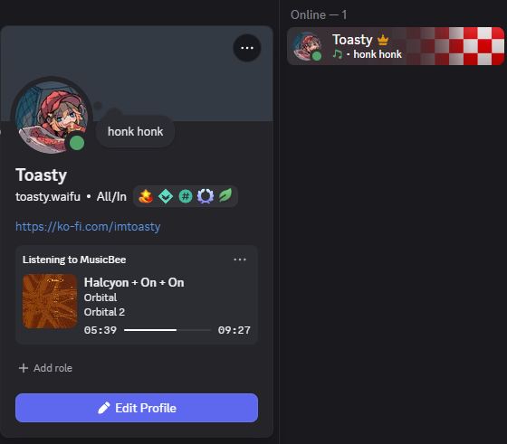

# BeePresence

A lightweight [MusicBee](https://getmusicbee.com/) plugin that shows what you're playing on Discord as **"Listening to"**, like Spotify does. It shows the track, artist, album cover and a live progress bar.

It's a single small DLL with no third-party dependencies.



## Why not DiscordBee?

[DiscordBee](https://github.com/sll552/DiscordBee) was the go-to plugin for this, but it no longer works properly with current Discord and hasn't been maintained since 2023:

- **Album art is broken.** DiscordBee uploaded covers to Imgur, which no longer works for anonymous uploads. The uploader now throws an exception on every track. On a long-running install this filled MusicBee's `ErrorLog.dat` to hundreds of MB and caused out-of-memory errors.
- **Discord changes since 2024** broke the time bar and cover images (see issues #243, #245, #253, #254).
- **Its dependency (DiscordRPC.dll) can clash** with older copies left in the MusicBee `Plugins` folder.

## How BeePresence is simpler

Discord now supports things that make most of DiscordBee's machinery unnecessary:

| | DiscordBee | BeePresence |
|---|---|---|
| Talking to Discord | discord-rpc-csharp library plus about a dozen support DLLs | ~150 lines speaking Discord's local IPC pipe directly |
| Album art | Uploads every cover to Imgur | Finds the cover on Last.fm, Deezer or iTunes and passes that URL straight to Discord, so nothing is uploaded |
| Activity type | "Playing" | "Listening to", with the artist shown in your status, like Spotify |

## Install

1. Download `mb_BeePresence.dll` from [Releases](../../releases).
2. Close MusicBee and copy it into `%APPDATA%\MusicBee\Plugins` (or `<MusicBee folder>\Plugins` for a portable install).
3. If you used DiscordBee, remove `mb_DiscordBee.dll`, `DiscordRPC.dll` and the `DiscordBee` folder from `Plugins`.
4. Start MusicBee. The Discord desktop app must be running.

## Settings

Open MusicBee **Preferences → Plugins**. The BeePresence settings appear right under the plugin:

- **Discord Application ID**: Discord shows this application's name as "Listening to &lt;name&gt;". To use your own name, click **Create your own…**, make an application at the Discord Developer Portal, and paste its Application ID here.
- **Keep showing the song while paused**
- **Show album cover from: Last.fm / Deezer / iTunes**: the enabled sources are tried in that order, from the most exact match to the loosest:
  - **Last.fm** looks up the exact artist and album, with typo autocorrection. It needs a free API key: click **Get a free key…**, fill in the form (only the application name is required), and paste the **API key** into the box. Without a key, Last.fm is skipped.
  - **Deezer** searches by artist and album, with no key needed.
  - **iTunes** does a keyword search, with no key needed. It works as a catch-all.

Changes apply as soon as you click **Save** or **Apply**; no restart is needed. The settings are stored in `%APPDATA%\MusicBee\BeePresence.ini`, and problems are logged to `BeePresence.log` in the same folder. The log is capped at 256 KB.

## Build

Requires the .NET SDK. The project targets .NET Framework 4.8.

```
dotnet build -c Release
```

The output is `bin/Release/net48/mb_BeePresence.dll`.

## Notes

- Covers are matched by artist and album name. Very obscure releases may get no cover or the wrong one. Last.fm gives the best matches for local libraries with messy tags.
- SoundCloud isn't supported as a cover source: its API has been closed to new apps for years, and searching it without one means scraping, which tends to break.
- `MusicBeeInterface.cs` is MusicBee's standard plugin API file (by Steven Mayall), included as in every MusicBee plugin. Everything else is original code.
